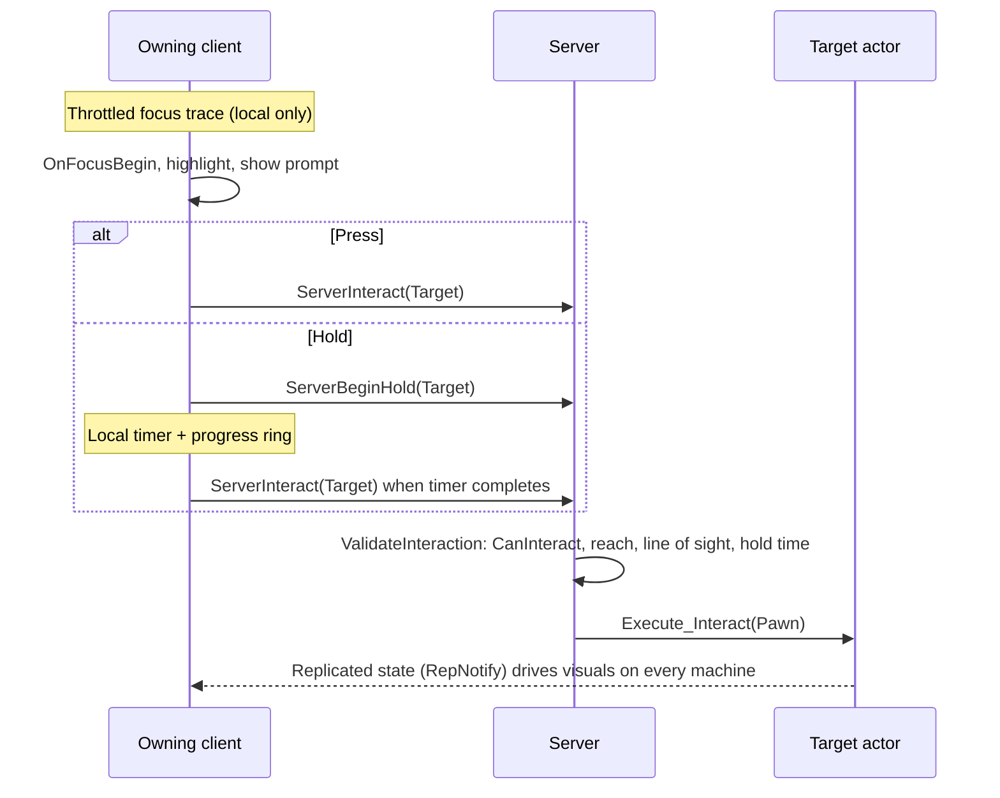

# InteractionLab: a drop-in Interaction System for Unreal Engine 5.6

A reusable, server-authoritative interaction framework: any actor can become interactable (doors,
pickups, switches, Blueprint-only props) with focus detection, outline highlighting, on-screen
prompts, and press or hold-to-interact. Gameplay code is C++; designers create new interactables in
Blueprint without touching C++.

- **Engine:** Unreal Engine 5.6.1 (Windows)
- **Core system:** `Plugins/InteractionSystem` (runtime plugin, no dependency on game code)
- **Examples:** `Source/InteractionLab/Interactables` (door, lever, pickup, inventory)

---

## Features

| Feature | How |
|---|---|
| Any actor can be interactable | `IInteractable` UINTERFACE with BlueprintNativeEvents |
| Focus detection | Camera-aligned line trace + forgiving sphere sweep on a dedicated trace channel, throttled (20 Hz default), local player only |
| Highlight | Custom depth + stencil on the focused actor's meshes, outlined by a post-process material |
| Prompt | `"E  Open Door"` widget anchored above the target; key name read live from Enhanced Input mappings |
| Press vs hold | Decided per interactable by `FInteractionData::HoldDuration`; progress ring; cancels on release or focus loss |
| Multiplayer | Client requests via Server RPC; server validates availability, reach, line of sight and hold time; state replicated with RepNotify |
| Data-driven | Distance, radius, channel, update rate, stencil, tolerances are all component properties |
| Debugging | `Interaction.Debug 1` (client traces + focus info), `Interaction.Debug 2` (+ server validation) |

---

## Architecture

```
Plugins/InteractionSystem/Source/InteractionSystem
├── Public
│   ├── Interactable.h              IInteractable: CanInteract, GetInteractionData, OnFocusBegin/End, Interact
│   ├── InteractionTypes.h          FInteractionData: Verb, ObjectName, HoldDuration
│   ├── InteractionComponent.h      UInteractionComponent: focus, input, hold, RPCs, validation
│   └── UI
│       ├── InteractionPromptWidget.h   C++ base for the prompt (BindWidget)
│       ├── InteractionProgressRing.h   UMG widget for the hold ring
│       └── SInteractionProgressRing.h  Slate widget that paints the ring
└── Private ...

Source/InteractionLab/Interactables
├── Switchable.h                ISwitchable: SetSwitchState(bOn, Source)
├── InteractableDoor.h/.cpp     IInteractable + ISwitchable, replicated swing
├── InteractableLever.h/.cpp    IInteractable, drives ISwitchable targets
├── InteractablePickup.h/.cpp   IInteractable, adds to inventory, destroys itself
└── InventoryComponent.h/.cpp   Replicated (owner-only) item counts
```

Dependencies are one-way: the game module depends on the plugin; the plugin knows nothing about
doors, levers or inventories.

### Interaction flow (networked)



### Key design decisions

**Interface, not base class.** `IInteractable` can be added to any actor, including ones that
already have a parent (a `ACharacter` NPC, a vehicle, a `AStaticMeshActor`) or Blueprint-only
actors. A base `AInteractableActor` would force every interactable into one inheritance chain.
Calls always go through `IInteractable::Execute_*` so Blueprint implementations are dispatched.

**Component on the pawn, not logic in the character.** `UInteractionComponent` owns focus, input,
hold timing and RPCs, so any pawn gains the feature by adding the component. It lives on the pawn
(not the PlayerController) so it follows possession and can reach the server through the pawn's
owning connection.

**Trace strategy.**
- Only the locally controlled player traces. Simulated proxies and the server's copies of remote
  players never do; tick is enabled and disabled from `ReceiveControllerChangedDelegate`.
- A throttled component tick (`FocusUpdateInterval`, 0.05 s by default) instead of per-frame. Focus
  latency of a frame or two is imperceptible, while trace cost on a listen server scales with
  players. Pressing interact forces an immediate refresh, so input never acts on stale focus.
- Line trace first (precise: what the crosshair is on wins), then a small sphere sweep that is
  clamped to the line's hit point (forgiving aim, but can't reach through walls).
- **Third-person correction:** the ray starts where the camera ray passes closest to the pawn, not at
  the camera. Otherwise the spring arm eats into reach, and objects *between* the camera and the
  character can be focused. In first person the offset is about 0, so the same code works for both.
- A dedicated `Interaction` trace channel (`ECC_GameTraceChannel2`, default Block) so designers can
  make glass, foliage or triggers ignore interaction independently of Visibility. The plugin
  defaults to `ECC_Visibility`; the game sets its own channel, because which `GameTraceChannel`
  slot is free is project-specific.

**Press vs hold lives in the component, not an Enhanced Input Hold trigger.** A Hold trigger's
threshold is baked into the input asset; here, hold duration is per-interactable data (a lamp 1 s,
a safe 3 s). The input action stays a plain button that reports Started and Completed.

**Server authority.** The client never performs an interaction; it asks. `ServerInteract`
re-checks `CanInteract`, reach to the closest point of the target's bounds (plus a lag tolerance),
line of sight from the pawn's eyes (not the client's camera, which the server can't trust), and
for holds, that the server's own clock saw at least `HoldDuration - HoldTimeTolerance` since
`ServerBeginHold`. Rejections are logged, not kicked: they're normally latency, not cheating, so
game rules are validated in the implementation rather than with `WithValidation`.

**Replication of results.** The component replicates nothing; interactables own their state.
The door replicates a single float (`TargetYaw`: 0 closed, ±OpenAngle open, which keeps "open" and
"which way" atomic) with a RepNotify that starts a local animation on every machine. Movement is
never replicated. Doors and levers use `DORM_Initial` net dormancy and `FlushNetDormancy()` on
change, so idle ones cost the server nothing. The inventory replicates `COND_OwnerOnly`.

**Soft vs hard references.**
- `PromptWidgetClass` is a `TSoftClassPtr`, async-loaded only when a pawn becomes locally
  player-controlled, so dedicated servers and AI never load UI.
- Lever targets are `TSoftObjectPtr<AActor>`, so in a World Partition level the lever doesn't force
  its targets to load with it.
- The door's `SwingCurve` and the `InteractAction` are hard refs on purpose: they're tiny and
  needed whenever their owner exists.
- No content paths in C++: meshes are assigned in Blueprint subclasses.

**UI separation.** The prompt widget only uses the component's public getters and
`OnFocusChanged`. C++ owns the behavior (what, when, where); the Widget Blueprint owns the look via
`BindWidget`. A project with its own HUD leaves `PromptWidgetClass` empty and binds to the delegates.

---

## Setup (already done in this project)

1. **Plugin:** `InteractionSystem` is enabled in `InteractionLab.uproject`, and the game module lists
   it in `PrivateDependencyModuleNames`.
2. **Project Settings > Collision:** trace channel `Interaction`, default response Block
   (`Config/DefaultEngine.ini`).
3. **Project Settings > Rendering > Custom Depth-Stencil Pass:** Enabled with Stencil
   (`r.CustomDepth=3`).
4. **Input:** `IA_Interact` (Digital/bool, *no triggers*) mapped in `IMC_Default` to `E` and
   Gamepad Face Button Left.
5. **Outline:** `M_InteractionOutline` (post-process material) in the level's unbound
   PostProcessVolume. Its `StencilValue` must match the component's `HighlightStencilValue` (252).
6. **Prompt:** `WBP_InteractionPrompt`, parent class `InteractionPromptWidget`, containing a
   `TextBlock` named `KeyText`, a `TextBlock` named `ActionText`, and optionally an
   `Interaction Progress Ring` named `HoldRing`. The root must size to content (Overlay or
   Horizontal Box), not a Canvas Panel.
7. **Character:** on `BP_ThirdPersonCharacter > InteractionComponent`, set `Interact Action` =
   `IA_Interact` and `Prompt Widget Class` = `WBP_InteractionPrompt`.

To use the system in another project, copy `Plugins/InteractionSystem`, then repeat steps 2–7.

---

## Adding a new interactable

### In C++

```cpp
// MySafe.h
#include "GameFramework/Actor.h"
#include "Interactable.h"
#include "MySafe.generated.h"

UCLASS()
class AMySafe : public AActor, public IInteractable
{
	GENERATED_BODY()
public:
	AMySafe() { bReplicates = true; }

protected:
	virtual FInteractionData GetInteractionData_Implementation(APawn* InteractingPawn) const override
	{
		FInteractionData Data;
		Data.Verb = NSLOCTEXT("Game", "Crack", "Crack");
		Data.ObjectName = NSLOCTEXT("Game", "Safe", "Safe");
		Data.HoldDuration = 3.f;   // 0 = press
		return Data;
	}

	virtual bool CanInteract_Implementation(APawn* InteractingPawn) const override { return !bOpened; }

	// Server only. Replicate whatever changes.
	virtual void Interact_Implementation(APawn* InteractingPawn) override { bOpened = true; OnRep_Opened(); }

	UPROPERTY(ReplicatedUsing = OnRep_Opened) bool bOpened = false;
	UFUNCTION() void OnRep_Opened() { /* play animation */ }
	// + GetLifetimeReplicatedProps with DOREPLIFETIME(AMySafe, bOpened)
};
```

Override only what you need; the defaults are `CanInteract = true`, the verb "Interact", a press
(not a hold), and no focus behavior. Make sure the actor's collision blocks the `Interaction` channel.

### In Blueprint (no C++)

1. Create an Actor Blueprint, then in **Class Settings > Interfaces** add `Interactable` (and
   `Switchable` if a lever should be able to drive it).
2. **Class Defaults:** tick `Replicates` if the interaction changes anything other players should see.
3. Implement **Get Interaction Data** (Make InteractionData: Verb, Object Name, Hold Duration).
4. Implement **Can Interact** and return **true**. The auto-generated graph returns false, which
   makes the actor show up as unavailable.
5. Implement **Event Interact**. It runs **on the server**, so set a `RepNotify` variable and drive
   visuals from its `OnRep` function (in Blueprint, setting a RepNotify variable also calls the
   OnRep on the server; in C++ you must call it yourself).
6. Optional: **Event On Focus Begin / On Focus End** for local cosmetic feedback.

`BP_InteractableLamp` in the test level is a complete example.

---

## Testing

- **Single player:** Play in the viewport. Open the console (`~`) and run `Interaction.Debug 1`.
- **Multiplayer:** Play dropdown, then **Number of Players: 2** and **Net Mode: Play As Listen
  Server**; repeat with **Play As Client** (dedicated server). On the server window,
  `Interaction.Debug 2` draws reach spheres and line-of-sight checks. Rejections appear in the
  Output Log under `LogInteraction`.
- **Latency:** Editor Preferences, then Level Editor > Play > Multiplayer Options > *Enable Network
  Emulation* (Average profile) exercises the distance and hold-time tolerances.

### Component settings

| Property | Default | Purpose |
|---|---|---|
| `InteractionDistance` | 250 cm | Reach, measured from the pawn |
| `TraceRadius` | 15 cm | Sphere sweep fallback radius (0 = line only) |
| `TraceChannel` | Visibility (game sets `Interaction`) | Focus and line-of-sight channel |
| `FocusUpdateInterval` | 0.05 s | Focus trace rate (0 = every frame) |
| `bHighlightFocusedActor` / `HighlightStencilValue` | true / 252 | Outline |
| `InteractAction` | — | Enhanced Input action |
| `PromptWidgetClass` / `PromptZOrder` | — / 10 | Soft class, local players only |
| `ServerDistanceTolerance` | 75 cm | Extra reach the server allows |
| `HoldTimeTolerance` | 0.2 s | Allowed hold-time shortfall on the server's clock |

---

## Known limitations

- **No client prediction:** a door starts moving after one round trip. A production version would
  play an immediate local cue (sound or animation start) and reconcile.
- **Actor-level only:** the interface is checked on the hit *actor*. Multiple interaction points on
  one actor (e.g. two buttons on a panel) would need component-level interactables.
- **RPC targets must be net-addressable:** replicated, or placed in the level (stably named). A
  runtime-spawned, non-replicated interactable can be focused but not used in multiplayer.
- **Highlight is whole-actor:** every mesh on the focused actor is outlined, and it overwrites any
  custom depth settings those meshes already had.
- **Key glyphs:** the prompt shows the first keyboard/mouse key mapped to the action; it doesn't
  switch to gamepad glyphs based on the last input device (CommonUI's input-type tracking would).
- **Late joiners:** a door that is already open animates open when it first replicates, instead of
  snapping.
- **Hold cancel isn't sent to the server:** harmless, because the server only uses the hold start as
  a lower bound, but the server can't tell a release from a long hold.
